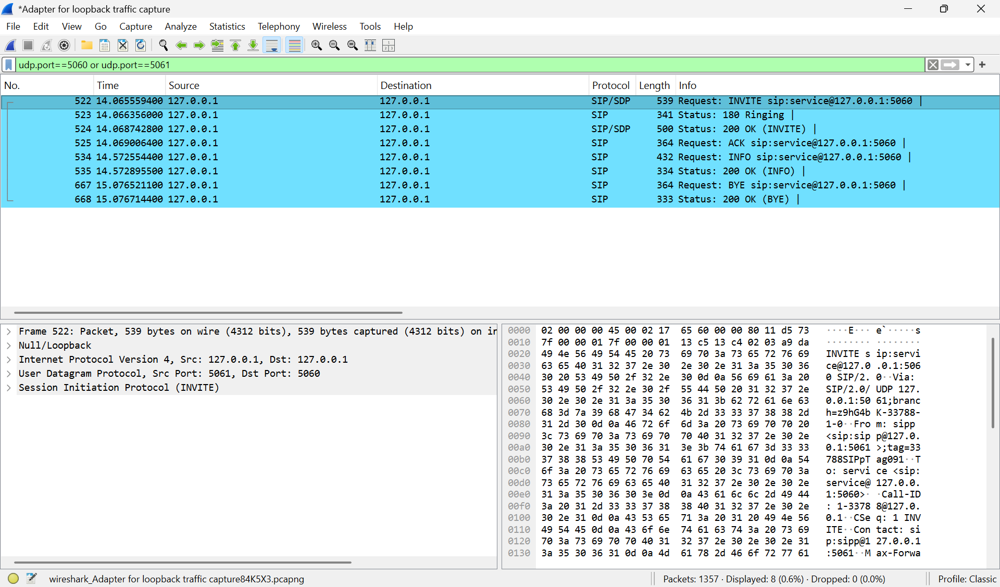

# SIP DTMF Signaling via INFO (application/dtmf-relay)

Hands-on analysis of SIP DTMF signaling using a custom SIPp scenario and
Wireshark — including a real platform limitation encountered along the way
and how it was worked around.

## Objective

Demonstrate and capture DTMF signal transmission over an established SIP
call, and understand the difference between the two real-world DTMF
delivery methods: RFC 2833 (in-band, over RTP) and SIP INFO (out-of-band,
pure signaling).

## Tools Used

- **Wireshark 4.6.9** — packet capture and protocol analysis
- **SIPp** (built from source as `sipp-rs`, the official Rust port, via
  Rust/Cargo on Windows) — SIP traffic generator (UAC/UAS roles)

## Lab Setup

- Local UAC (caller) and UAS (callee), both bound to `127.0.0.1`,
  communicating over UDP.
- Captured on the Npcap Loopback Adapter.
- Custom SIPp scenario: [`scenarios/uac_info_dtmf.xml`](scenarios/uac_info_dtmf.xml)

## The Problem: RFC 2833 DTMF Needs Raw Sockets

The first attempt used SIPp's built-in RTP-based DTMF features
(`play_pcap_audio` playing a pre-recorded `dtmf_2833_*.pcap` file, and the
`play_dtmf` action which generates RFC 2833 telephone-events on the fly).
Both failed on Windows with:

```
Can't create raw IPv4 socket (need to run as root?): An attempt was made to
access a socket in a way forbidden by its access permissions.
```

This is a genuine, documented SIPp constraint — its RTP/PCAP-play features
need raw socket access (root on Linux, Administrator on Windows), which
wasn't available in this environment (a restricted, non-elevated account).

## The Fix: SIP INFO-Based DTMF Relay

Rather than force elevation, the scenario was rebuilt around **SIP INFO with
an `application/dtmf-relay` body** — a real, production-used alternative to
RFC 2833 (the same method Cisco CUCM/CUBE support for DTMF relay). This only
needs ordinary SIP signaling, no RTP or raw sockets at all.

Commands used:
```
# UAS (-aa enables automatic 200 OK for INFO/NOTIFY/OPTIONS/UPDATE)
sipp-rs -sn uas -i 127.0.0.1 -p 5060 -aa

# UAC (custom scenario sending a DTMF digit via SIP INFO)
sipp-rs -sf scenarios/uac_info_dtmf.xml 127.0.0.1:5060 -i 127.0.0.1 -p 5061 -m 1
```

## Captured Call Flow



| # | Frame | Message | Description |
|---|-------|---------|-------------|
| 1 | 522 | INVITE | Call setup request |
| 2 | 523 | 180 Ringing | Provisional response |
| 3 | 524 | 200 OK | Call accepted |
| 4 | 525 | ACK | Handshake complete |
| 5 | 534 | **INFO** | DTMF relay: `Signal=5`, `Duration=200` |
| 6 | 535 | 200 OK | INFO acknowledged (via UAS `-aa` flag) |
| 7 | 667 | BYE | Call teardown initiated |
| 8 | 668 | 200 OK | Teardown confirmed |

## DTMF Payload Detail


The `INFO` request body confirms the DTMF relay payload exactly as sent:
```
Content-Type: application/dtmf-relay
Signal=5
Duration=200
```

## Key Takeaways

- Wrote a custom SIPp XML scenario to generate a specific SIP method
  (`INFO`) with a custom body, rather than relying only on built-in
  scenarios.
- Hit a real platform constraint (Windows raw-socket restrictions blocking
  RFC 2833 RTP-based DTMF) and diagnosed it correctly rather than assuming
  it was a scenario/syntax bug.
- Adapted by implementing SIP INFO-based DTMF relay instead — a real,
  production-used alternative method (the same one Cisco CUCM/CUBE support),
  not just a workaround.
- Learned to distinguish RFC 2833 (in-band RTP telephone-events) from SIP
  INFO (out-of-band signaling) DTMF delivery — a practical distinction when
  troubleshooting real VoIP DTMF issues.
